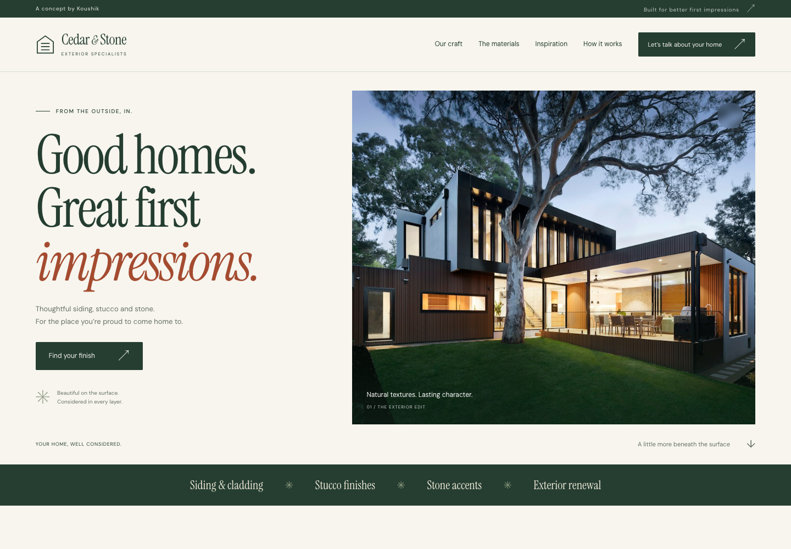

# Cedar & Stone · Contractor website demo

An original, responsive exterior contractor concept built for Koushik to demonstrate to prospective clients. Inspired by the interaction ideas in [this reel by @joebuildswithai](https://www.instagram.com/reel/DendM5Rjk3Y/).

Live website: [koushik2002.github.io/cedar-stone/](https://koushik2002.github.io/cedar-stone/) · Source: [koushik2002/cedar-stone](https://github.com/koushik2002/cedar-stone)

**Bengaluru rebuild:** [koushik2002.github.io/cedar-stone/demo/](https://koushik2002.github.io/cedar-stone/demo/) — masonry, paint/plaster/brick/jali/stone, a local palette, researched neighbourhood distances and a Bengaluru project brief. See the [research and plan](docs/BENGALURU-RESEARCH-PLAN.md), [demo source guide](demo/README.md) and [current verification](docs/bengaluru-demo/QA.md).



The saved 17.7-second reference video was reviewed twice, including close inspection of the wall, material track and tape transitions. It shows **Lath & Lap Exteriors**: a stucco/siding website with a wall-coating interaction, material samples, service navigation and a tape-measure service-area section. This demo uses an original brand, layout, text, textures and implementation. No reference footage or screenshots are distributed in the site.

## Open the demo

Double-click **index.html**. There is no installation or build step. For a local HTTP preview, run from this folder:

```sh
python3 -m http.server 8000
```

Then visit `http://localhost:8000`.

## What works

- Responsive navigation and layouts for desktop and mobile.
- Opening wall with pointer troweling, four scroll-driven coats with rough edges, stage buttons and a keyboard/touch slider.
- Full-wall texture and colour exploration, with the selected finish carried into the brief.
- Twelve original material samples in a continuous horizontal track: eight siding, three stucco and one stone. Desktop scrolling drives the track; mobile uses native swipe and navigation buttons.
- Illustrated services and four process rows with advancing background fills.
- An extending yellow measuring tape with graduations, a metal hook and seven alternating illustrative place labels.
- Normal scrolling and manual controls when reduced motion is preferred or the viewport is too short to pin sections.
- Select a material and carry it into the project brief.
- Three switchable home inspiration concepts.
- Expandable FAQs.
- Three-step project brief with field validation, back navigation, downloadable text, clipboard copy and reset.
- Local fonts and imagery; the site makes no third-party requests during use.

**Demo boundary:** Cedar & Stone is fictional. Photography is stock inspiration, not completed work. The brief is held in page memory and is not sent or saved to a server. Refreshing clears it. Clipboard access depends on browser permissions; downloading works independently. There is no booking system, email delivery, CRM, admin dashboard or verified service territory.

## Put it on GitHub Pages

1. Create a repository, for example `cedar-stone`. A public repository works with GitHub Free.
2. Upload **the contents of this folder** to the repository root. `index.html`, both CSS files, both JavaScript files and `assets/` must sit at that root, rather than inside an extra `cedar-stone` folder. Include `.nojekyll` if using Git; a browser upload may omit hidden files, but this simple site also works with the default Jekyll processing.
3. Open **Settings → Pages**. Under **Build and deployment**, select **Deploy from a branch**.
4. Choose **main** and **/(root)**, then save.
5. When deployment completes, use **Visit site**. Your link follows this pattern: `https://koushik2002.github.io/cedar-stone/`.

All asset links are relative, so the demo supports a GitHub Pages repository subdirectory. No API keys, environment variables, npm packages or GitHub Actions file are needed.

Optional terminal route, after creating an empty repository:

```sh
cd /path/to/cedar-stone
git init -b main
git add .
git commit -m "Add Cedar and Stone contractor demo"
git remote add origin https://github.com/koushik2002/cedar-stone.git
git push -u origin main
```

The deployment repository is `koushik2002/cedar-stone`, with Pages publishing from `main` at the repository root.

GitHub references: [publish from a branch](https://docs.github.com/en/pages/getting-started-with-github-pages/configuring-a-publishing-source-for-your-github-pages-site), [create a Pages site](https://docs.github.com/en/pages/getting-started-with-github-pages/creating-a-github-pages-site). Checked 18 October 2026.

## Show it to a client

Use the [client pitch and delivery plan](docs/CLIENT-PITCH-PLAN.md). It includes a two-minute walkthrough, an outreach draft, scope options, proposed example pricing and a delivery schedule. [Reference analysis](docs/REFERENCE-ANALYSIS.md) separates observations from the pitch interpretation.

Validation: **69 browser checks passed**, with no failures, plus static asset checks. See the [QA record](docs/QA.md). See the [mobile preview](docs/mobile-preview.png), [material track](docs/materials-preview.png) and [measuring tape](docs/tape-preview.png).

## Personalise for a real business

| Change | Where |
| --- | --- |
| Brand, positioning, navigation, FAQs, process | `index.html` |
| Colours, spacing, type sizes, breakpoints | `styles.css` and `motion.css` |
| Scroll scenes, trowel, finish choices, tape locations/distances | `motion.js` |
| Materials and inspiration content | `materials` and `projects` at the top of `app.js` |
| Photographs and textures | `assets/` |
| Website creator credit | Concept bar and footer in `index.html` |
| Form questions and delivery behaviour | `index.html` and the form handlers in `app.js` |

Before a real launch, replace the fictional identity and illustrative samples, add approved project photographs, confirm contact details and service territory, and connect/test the chosen enquiry delivery service. Do not label an enquiry as sent until the endpoint confirms it. Keep credentials out of the frontend. Confirm client-specific privacy, assembly, warranty and product claims before publishing them.

## Files

```text
index.html            Website
styles.css            Shared design and form/dialog styles
motion.css            Responsive wall, material, process and tape scenes
app.js                Catalogue, navigation and local project brief
motion.js             Scroll scenes, trowel, finish picker and tape
assets/               Local photos, SVG textures, fonts and license notices
docs/                 Pitch plan, source analysis, asset credits and QA record
.nojekyll             Bypass Jekyll when included in the publishing source
```

See [asset credits](docs/ASSET-CREDITS.md) for third-party assets and their terms. The source is prepared for a portfolio demonstration; production services require a separate scope.
